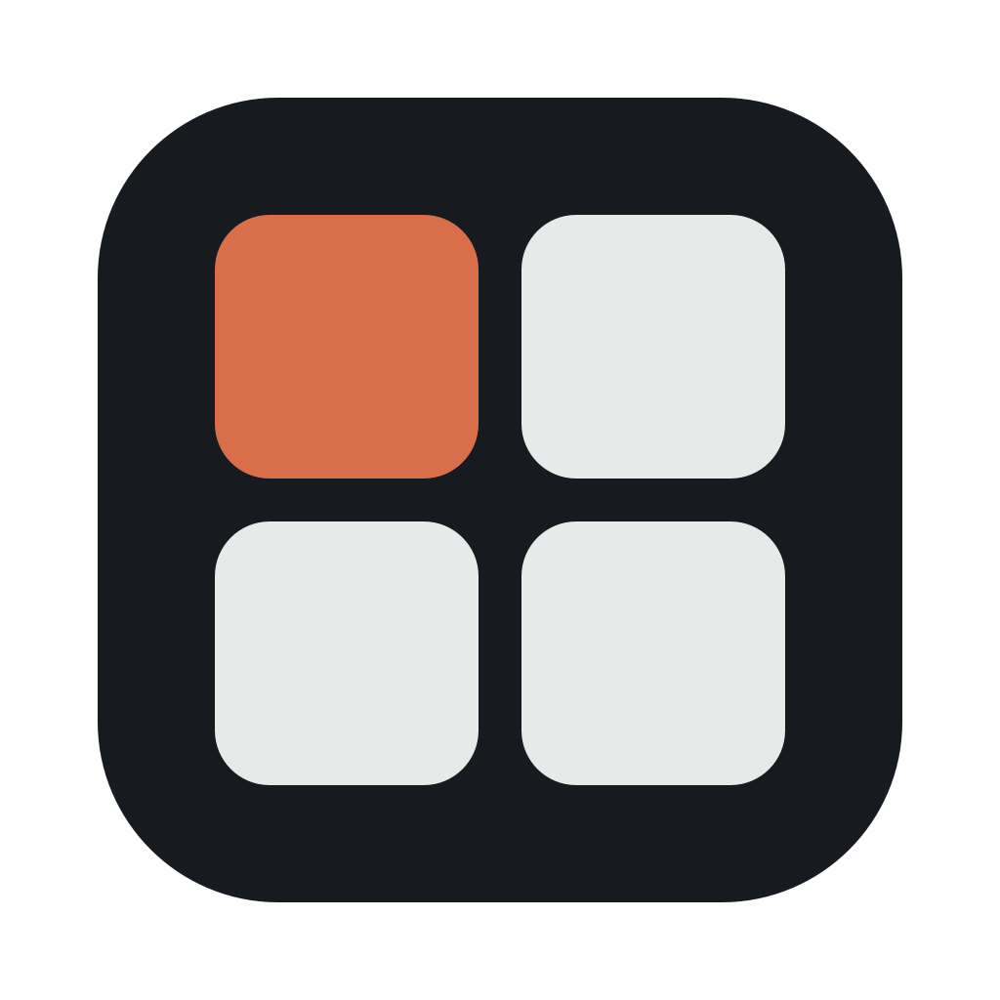

<p align="center"></p>

# Square

Toutes les fenêtres du Mac en plein écran, sur un seul bureau, et une grille pour passer de l'une à l'autre.

Le plein écran de macOS range chaque app dans un espace à part : on glisse d'un espace à l'autre, on attend l'animation, et aucune autre fenêtre ne peut venir par-dessus. Square fait remplir l'écran aux fenêtres en les laissant sur le même bureau. Changer d'app devient instantané.

## Ce que fait Square

- **La grille** : un coin de l'écran ou un raccourci (⌥ Tab par défaut) affiche toutes les fenêtres en vignettes, sur le fond d'écran flouté. Un clic, un chiffre ou la molette de la souris choisit la fenêtre.
- **Quatre doigts** : un glissement vers la gauche ou la droite passe à la fenêtre voisine. Posé, le geste fait apparaître un carrousel de cartes qui suit les doigts ; rapide, il change de fenêtre sans rien afficher.
- **Ranger** : dans la grille, glisser une vignette sur le milieu d'une autre change l'ordre. La glisser sur un bord partage l'écran entre les deux fenêtres, en deux, trois ou quatre bandes. Tirer la séparation les redimensionne.
- **Un Dock dans la grille** : une copie du Dock de macOS, avec sa loupe, placée en bas, en haut, à gauche ou à droite. Son premier bouton ouvre la liste de toutes les apps.
- **Le bouton vert** : il remplit l'écran sans passer en plein écran d'Apple. Les nouvelles fenêtres peuvent s'agrandir toutes seules.
- **Des raccourcis directs** : ⌘1 à ⌘9 pour aller droit à une fenêtre (touche au choix, ou désactivé).
- **Des réglages** façon Réglages Système, et une courte présentation en images à la première ouverture.

## Installation

Il faut un Mac à puce Apple, macOS 14 ou plus récent, et les outils de ligne de commande d'Apple (`xcode-select --install`).

```bash
git clone https://github.com/GauthierAube/Square.git
cd Square
./build.sh
```

Le script compile Square, l'installe dans `~/Applications` et le lance. Une icône apparaît dans la barre des menus.

À savoir : sans certificat de développeur Apple dans le trousseau, Square est signé avec une signature jetable. macOS redemande alors les autorisations après chaque compilation.

## Autorisations et vie privée

- Square ne se connecte à aucun serveur : rien ne quitte le Mac.
- **Accessibilité** : indispensable. C'est ce qui permet de déplacer et d'agrandir les fenêtres des autres apps.
- **Enregistrement de l'écran** : pour les vignettes de la grille. Les images restent en mémoire, le temps que la grille s'affiche ; rien n'est écrit sur le disque. Sans cette autorisation, la grille montre les icônes des apps.
- Le geste à quatre doigts lit le trackpad par un module de macOS qu'Apple ne documente pas (le même que celui des outils de gestes).

## Avec Side et Mulot

Square fonctionne seul, et s'entend avec deux autres petites apps :

- **[Side](https://github.com/GauthierAube/Side)**, un Finder qui flotte par-dessus les apps. Square ne touche pas à ses fenêtres, et les gestes à quatre doigts se partagent : horizontal pour Square, vertical pour Side.
- **[Mulot](https://github.com/GauthierAube/Mulot)**, pour les souris Logitech MX Master. Quand Square est installé, Mulot propose ses actions (grille, fenêtre suivante ou précédente) sur les boutons et la molette du pouce.

## Limites connues

- Projet personnel, écrit rapidement avec l'aide d'une IA : il reste sûrement des bugs.
- L'interface est en français uniquement.
- Pensé pour un seul bureau. Avec plusieurs bureaux, le geste à quatre doigts est laissé à macOS.
- Certaines apps refusent de descendre sous une largeur minimale : en écran partagé, leurs fenêtres peuvent se chevaucher.
- Les fenêtres encore dans un plein écran d'Apple apparaissent dans la grille, mais ne peuvent pas être partagées. Un bouton des réglages les en sort.

## Licence

MIT — voir [LICENSE](LICENSE).

## Historique

Les changements sont notés dans [changes-square.md](changes-square.md), du plus récent au plus ancien.
